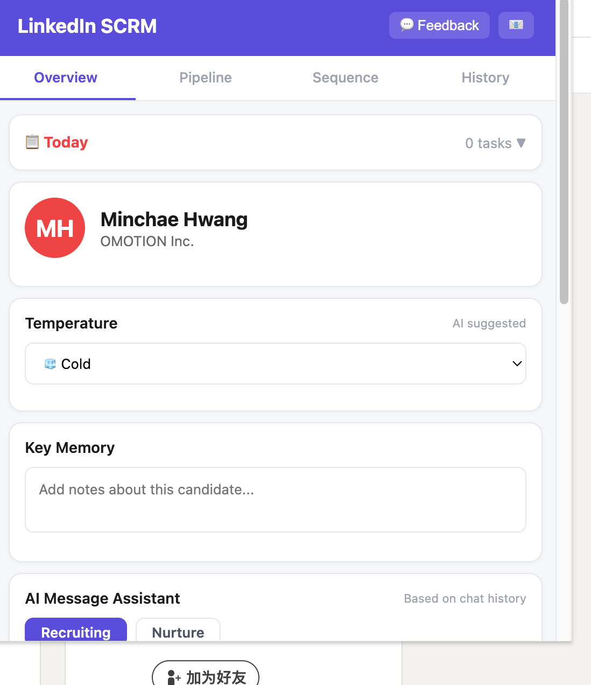


popup.js:2106 [PLUGIN_INIT] ===== 插件初始化开始 =====
db.js:15 [PLUGIN_INIT] ensureUserId START
db.js:22 [PLUGIN_INIT] ensureUserId END 耗时=18.1ms
popup.js:2064 [PLUGIN_INIT] initBackendData START
popup.js:2056 [PLUGIN_INIT] pipeline stages loaded from cache, count=5
api.js:42 [API_PERF] GET /api/v1/pipeline/stages START
popup.js:2101 [PLUGIN_INIT] initBackendData END 耗时=2.5ms
popup.js:170 [PLUGIN_INIT] loadCurrentCandidate START
popup.js:243 [PLUGIN_INIT] loadCurrentCandidate END 耗时=0.9ms
popup.js:448 [PLUGIN_INIT] renderOverviewTodayTasks START
api.js:42 [API_PERF] GET /api/v1/candidates/tasks START
api.js:49 [API_PERF] GET /api/v1/pipeline/stages storageReady apiBase=0.9ms userId=1.0ms
api.js:49 [API_PERF] GET /api/v1/candidates/tasks storageReady apiBase=0.1ms userId=0.7ms
api.js:77 [API_PERF] GET /api/v1/pipeline/stages networkDone fetch=1113.6ms
api.js:94 [API_PERF] GET /api/v1/pipeline/stages END total=1122.5ms
api.js:77 [API_PERF] GET /api/v1/candidates/tasks networkDone fetch=1121.4ms
api.js:94 [API_PERF] GET /api/v1/candidates/tasks END total=1123.1ms
popup.js:502 [PLUGIN_INIT] renderOverviewTodayTasks END 耗时=1123.3ms
popup.js:2599 [PLUGIN_INIT] initBindEmailState START
api.js:42 [API_PERF] GET /api/v1/user/me START
api.js:49 [API_PERF] GET /api/v1/user/me storageReady apiBase=0.1ms userId=0.6ms
api.js:77 [API_PERF] GET /api/v1/user/me networkDone fetch=234.2ms
api.js:94 [API_PERF] GET /api/v1/user/me END total=247.4ms
popup.js:2610 [PLUGIN_INIT] initBindEmailState END 耗时=247.7ms
popup.js:2118 [PLUGIN_INIT] ===== 插件初始化完成 总耗时=1394.2ms =====

