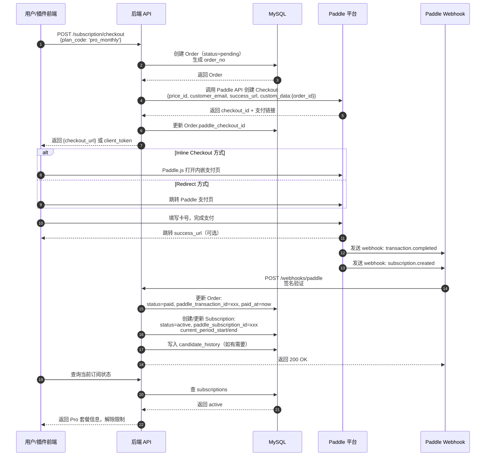

# Paddle 支付完整流程图

> **占位符说明**：文档中所有 `YOUR_CLIENT_TOKEN` / `YOUR_API_KEY` / `YOUR_WEBHOOK_SECRET` 需替换为实际密钥。
>其中 YOUR_CLIENT_TOKEN = test_5da3dc2731cc4791072992f74f6


---

## 1. 首次订阅主流程（时序图）



---

## 2. 前端 JS 伪代码（浏览器插件内）

```javascript
// ============================================================
// 前端 Paddle 初始化与支付调用
// 注意：以下 YOUR_CLIENT_TOKEN 需替换为实际 Client-side Token
// ============================================================

// 1. 初始化 Paddle.js（插件加载时执行一次）
Paddle.Initialize({
  token: 'YOUR_CLIENT_TOKEN',   // <-- 替换为实际 Client-side Token
  environment: 'sandbox'      // 测试用 sandbox，上线后改为 'production'
});

// 2. 用户点击 "Upgrade to Pro" 按钮时
async function handleUpgrade(planCode) {
  // 2.1 先调后端创建订单和 Checkout
  const res = await fetch('/api/v1/subscription/checkout', {
    method: 'POST',
    headers: { 'Content-Type': 'application/json' },
    body: JSON.stringify({
      plan_code: planCode,           // 'pro_monthly' 或 'pro_yearly'
      success_url: 'https://your-extension-page.com/success',
      cancel_url: 'https://your-extension-page.com/cancel'
    })
  });
  const { checkout_id, client_token, checkout_url } = await res.json();

  // 2.2 方式 A：Inline Checkout（内嵌弹窗，体验更好）
  Paddle.Checkout.open({
    items: [
      { priceId: 'pri_xxx', quantity: 1 }  // priceId 由后端返回或前端硬编码
    ],
    customer: {
      email: 'user@example.com'           // 当前登录用户邮箱
    },
    customData: {
      order_id: checkout_id               // 传给 Paddle，webhook 时原样返回
    },
    settings: {
      successUrl: 'https://your-extension-page.com/success',
      cancelUrl: 'https://your-extension-page.com/cancel'
    }
  });

  // 2.3 方式 B：Redirect Checkout（简单跳转）
  // window.location.href = checkout_url;
}

// 3. 支付结果监听（Inline 方式可选）
Paddle.Checkout.on('completed', (data) => {
  console.log('Payment completed', data);
  // 建议：3 秒后主动调后端刷新订阅状态
  setTimeout(() => refreshSubscriptionStatus(), 3000);
});

Paddle.Checkout.on('cancelled', (data) => {
  console.log('Payment cancelled', data);
});

// 4. 查询当前订阅状态（支付后或页面刷新时调用）
async function refreshSubscriptionStatus() {
  const res = await fetch('/api/v1/subscription/current', {
    headers: { 'Authorization': 'Bearer ' + getAuthToken() }
  });
  const sub = await res.json();

  if (sub.status === 'active') {
    // 解除限制：显示 AI 按钮、允许创建多个 Sequence 等
    enableProFeatures();
  } else {
    applyFreeLimits();
  }
}
```

---

## 3. 后端伪代码（Python / Java / Node 通用逻辑）

```python
# ============================================================
# 后端 Paddle 集成伪代码
# 密钥通过环境变量注入，禁止硬编码
# ============================================================

import os
from datetime import datetime

# 1. 环境变量读取（启动时加载，缺失则报错）
PADDLE_API_KEY        = os.environ.get('PADDLE_API_KEY')        # Server-side API Key
PADDLE_WEBHOOK_SECRET = os.environ.get('PADDLE_WEBHOOK_SECRET') # Webhook 签名验证密钥
PADDLE_ENVIRONMENT    = os.environ.get('PADDLE_ENVIRONMENT', 'sandbox')  # sandbox | production

if not PADDLE_API_KEY or not PADDLE_WEBHOOK_SECRET:
    raise RuntimeError("Paddle credentials missing in environment variables")

# 2. 创建 Checkout（用户点击升级时）
def create_checkout(user, plan_code):
    # 2.1 查套餐
    plan = SubscriptionPlan.find_by_code(plan_code)

    # 2.2 创建本地 Order（pending 状态）
    order = Order.create(
        user_id=user.id,
        plan_id=plan.id,
        status='pending',
        amount=plan.price,
        currency=plan.currency,
        billing_cycle=plan.billing_cycle,
        order_no=generate_order_no()
    )

    # 2.3 调 Paddle API 创建 Checkout
    # POST https://api.paddle.com/checkout
    paddle_resp = paddle_api_post('/checkout', headers={
        'Authorization': f'Bearer {PADDLE_API_KEY}'
    }, json={
        'items': [{'priceId': plan.paddle_price_id, 'quantity': 1}],
        'customer': {'email': user.email},
        'successUrl': 'https://your-extension-page.com/success',
        'cancelUrl': 'https://your-extension-page.com/cancel',
        'customData': {'order_id': order.id}   # 关键：webhook 时原样返回
    })

    # 2.4 保存 Paddle checkout_id
    order.update(paddle_checkout_id=paddle_resp['data']['id'])

    return {
        'checkout_url': paddle_resp['data']['url'],
        'checkout_id': order.paddle_checkout_id,
        'client_token': 'YOUR_CLIENT_TOKEN'   # 如用 Inline 方式，返回前端初始化用
    }

# 3. Webhook 接收与处理（唯一可信的支付成功来源）
@app.post("/api/v1/webhooks/paddle")
def handle_paddle_webhook(request):
    payload = request.body
    signature = request.headers.get('paddle-signature')

    # 3.1 签名验证（必须，防伪造）
    if not verify_paddle_signature(payload, signature, PADDLE_WEBHOOK_SECRET):
        return HTTP_401_UNAUTHORIZED

    event = request.json
    event_type = event['event_type']
    data = event['data']

    # 3.2 从 custom_data 取出 order_id
    order_id = data.get('customData', {}).get('order_id')

    # 3.3 幂等：用 Paddle ID 去重
    paddle_transaction_id = data.get('id')

    match event_type:
        # ---------------------------------------------------------------
        # A. 交易完成（支付成功）
        # ---------------------------------------------------------------
        case 'transaction.completed':
            if Order.exists_paddle_transaction(paddle_transaction_id):
                return HTTP_200_OK  # 已处理过，幂等返回

            order = Order.find(order_id)
            order.update(
                status='paid',
                paddle_transaction_id=paddle_transaction_id,
                paid_at=datetime.utcnow()
            )
            # 注意：此时不创建 subscription，等 subscription.created

        # ---------------------------------------------------------------
        # B. 订阅创建（首次购买成功）
        # ---------------------------------------------------------------
        case 'subscription.created':
            paddle_sub_id = data['id']
            if Subscription.exists_paddle_id(paddle_sub_id):
                return HTTP_200_OK

            sub = Subscription.create(
                user_id=order.user_id if order else None,
                plan_id=order.plan_id if order else None,
                paddle_subscription_id=paddle_sub_id,
                paddle_customer_id=data['customerId'],
                status='active',
                payment_provider='paddle',
                current_period_start=data['currentBillingPeriod']['startsAt'],
                current_period_end=data['currentBillingPeriod']['endsAt']
            )

            # 关联 order 和 subscription
            if order_id:
                Order.find(order_id).update(subscription_id=sub.id)

        # ---------------------------------------------------------------
        # C. 订阅更新（续费成功 / 升降级）
        # ---------------------------------------------------------------
        case 'subscription.updated':
            sub = Subscription.find_by_paddle_id(data['id'])
            sub.update(
                status=map_paddle_status(data['status']),  # active/past_due/canceled
                current_period_start=data['currentBillingPeriod']['startsAt'],
                current_period_end=data['currentBillingPeriod']['endsAt'],
                updated_at=datetime.utcnow()
            )

            # 如果是续费，创建新 Order 记录
            if data.get('billingCycle'):
                Order.create(
                    user_id=sub.user_id,
                    plan_id=sub.plan_id,
                    subscription_id=sub.id,
                    status='paid',
                    paddle_subscription_id=data['id'],
                    amount=sub.plan.price,
                    billing_cycle=sub.plan.billing_cycle,
                    paid_at=datetime.utcnow()
                )

        # ---------------------------------------------------------------
        # D. 订阅取消（用户主动取消或到期不续）
        # ---------------------------------------------------------------
        case 'subscription.canceled':
            sub = Subscription.find_by_paddle_id(data['id'])
            sub.update(
                status='cancelled',
                cancelled_at=datetime.utcnow()
            )

        # ---------------------------------------------------------------
        # E. 订阅过期（未支付，进入宽限期后过期）
        # ---------------------------------------------------------------
        case 'subscription.past_due' | 'subscription.payment_failed':
            sub = Subscription.find_by_paddle_id(data['id'])
            sub.update(status='past_due')

    return HTTP_200_OK

# 4. 查询当前订阅（前端轮询或刷新时调用）
@app.get("/api/v1/subscription/current")
def get_current_subscription(user):
    sub = Subscription.find_active_by_user(user.id)
    if not sub:
        return {'plan_code': 'free', 'status': 'inactive'}

    plan = SubscriptionPlan.find(sub.plan_id)
    return {
        'plan_code': plan.plan_code,
        'status': sub.status,
        'current_period_end': sub.current_period_end,
        'cancel_at_period_end': sub.cancel_at_period_end
    }

# 5. 用户主动取消订阅
@app.post("/api/v1/subscription/cancel")
def cancel_subscription(user):
    sub = Subscription.find_active_by_user(user.id)
    if not sub or sub.payment_provider != 'paddle':
        return HTTP_400_BAD_REQUEST

    # 调 Paddle API 取消（at_period_end=1 表示到期后取消）
    paddle_api_post(
        f'/subscriptions/{sub.paddle_subscription_id}/cancel',
        headers={'Authorization': f'Bearer {PADDLE_API_KEY}'},
        json={'effectiveFrom': 'next_billing_period'}
    )

    sub.update(cancel_at_period_end=1)
    return {'success': True}
```

---

## 4. 状态流转与关键操作对照表

| 业务动作 | 前端行为 | 后端行为 | Order 状态 | Subscription 状态 | Paddle 交互 |
|---------|---------|---------|-----------|------------------|------------|
| **点击升级** | 调后端创建 checkout | 创建 Order，调 Paddle 生成 checkout | `pending` | 无变化 | `POST /checkouts` |
| **支付成功** | 等待 / 跳转回插件 | Webhook 接收 `transaction.completed` | `pending` → `paid` | 无变化 | Webhook |
| **订阅生效** | 刷新状态 | Webhook 接收 `subscription.created` | 保持 `paid` | 无 → `active` | Webhook |
| **用户主动取消** | 点"Cancel" | 调 Paddle API 取消订阅 | 保持 `paid` | `active` → `cancel_at_period_end=1` | `POST /subscriptions/{id}/cancel` |
| **到期自动取消** | 不可用 | Webhook 接收 `subscription.canceled` | 保持 `paid` | `active` → `cancelled` | Webhook |
| **续费成功** | 无感知 | Webhook 接收 `subscription.updated` | 新建 Order `paid` | 更新 `current_period_end` | Webhook |
| **支付失败** | 显示失败 | Webhook 接收 `subscription.past_due` | `pending` → `failed` | `active` → `past_due` | Webhook |

---

## 5. 环境变量配置模板

```bash
# .env 文件（后端环境变量，禁止提交到 Git）
PADDLE_API_KEY=YOUR_API_KEY              # Server-side API Key
PADDLE_WEBHOOK_SECRET=YOUR_WEBHOOK_SECRET # Webhook 签名密钥
PADDLE_ENVIRONMENT=sandbox               # sandbox 或 production

# 前端不需要 API Key，只需要 Client-side Token（可硬编码在前端代码中）
# Paddle.Client-side Token 权限受限，暴露无风险
```

---

## 6. 时序要点（防坑指南）

1. **Order 必须先创建**：用户点击升级瞬间就要落库 `pending`，再把 `order_id` 塞进 Paddle `customData`，这样 webhook 回来才能关联。
2. **Webhook 可能乱序**：`transaction.completed` 和 `subscription.created` 可能同时或先后到达，处理要幂等（用 `paddle_transaction_id` / `paddle_subscription_id` 去重）。
3. **不要靠前端跳转判断成功**：用户可能关闭页面不跳回，唯一可信的是 Webhook。
4. **续费不用前端参与**：Paddle 自动扣款，后端只收 `subscription.updated` webhook，更新 `current_period_end` 即可。
5. **密钥分层**：
    - `Client-side Token` → 放前端 JS，初始化 Paddle.js 用
    - `API Key` → 放后端 `.env`，调 Paddle REST API 用
    - `Webhook Secret` → 放后端 `.env`，验证 webhook 签名用
